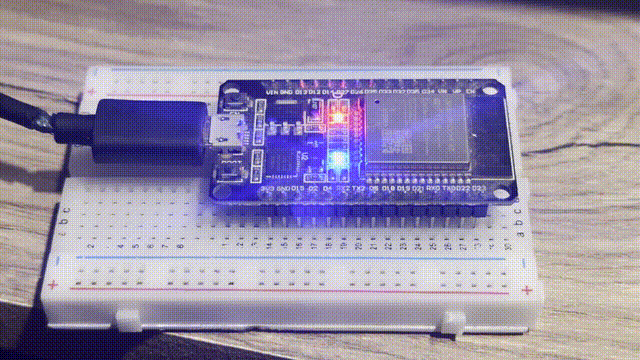
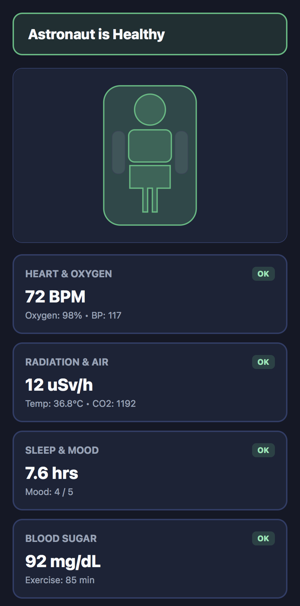
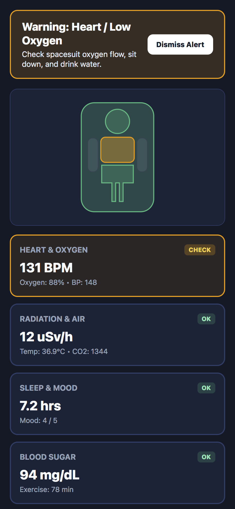
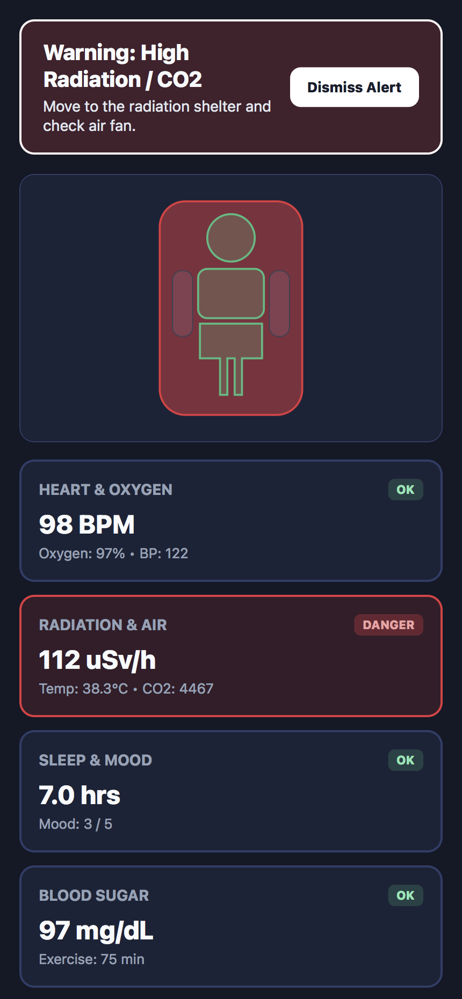

# BiometrAR

**Autonomous Astronaut Health Monitoring Prototype Powered by Edge AI on an ESP32**

---

## Live Demo and Gallery

<!-- Drop demo.gif, pic1.png, pic2.png, pic3.png into the assets/ folder, or drag-and-drop them directly into this file on GitHub -->

<div align="center">
  
  <p><em>ESP32 hardware prototype running the AI model and offline Wi-Fi web server.</em></p>
</div>

| Healthy Status View | Low Oxygen Warning | High Radiation / CO2 Warning |
| :---: | :---: | :---: |
|  |  |  |
| *All vitals normal* | *Chest zone and Heart/Oxygen alert active* | *Suit shield and Radiation/CO2 alert active* |

---

## Quick Start

1. **Flash the ESP32:** Open `esp32_triage/esp32_triage.ino` in the Arduino IDE, select your **ESP32** board and USB port, and click **Upload**.
2. **Connect to the ESP32 Wi-Fi:** Connect your phone or laptop to the **`NASA-EVA-TRIAGE`** Wi-Fi network (password: **`artemis2026`**).
3. **Open the Monitor:** Go to **`http://192.168.4.1`** in your web browser.

---

## The Problem We Solved

Long-duration space missions expose astronauts to space radiation, isolation and confinement, altered gravity, and a hostile closed environment. Over time, these hazards can cause immune system changes, bone and muscle loss, cardiovascular strain, and sleep or behavioral issues. On long missions, astronauts carry much of the responsibility for spotting these health changes in themselves and knowing how to respond.

**BiometrAR** solves this by gathering 10 key health and cabin indicators and turning them into a clear, easy-to-read visual monitor that tells the astronaut:
1. **What their current health status is** at a single glance (using a color-coded astronaut figure and 4 simple cards).
2. **Which body system is affected** (Heart and Oxygen, Radiation and Air, Sleep and Mood, or Blood Sugar and Exercise).
3. **What immediate action to take** in plain, everyday language when something goes wrong.

---

## Our Approach

Instead of relying on basic `if/else` rules or an expensive computer, **BiometrAR** combines two core ideas:

* **MLP Neural Network Triage:** In spaceflight, multiple small changes often happen together (such as a mild fever + elevated radiation + a faster heart rate). We trained a **Multi-Layer Perceptron (`10 -> 32 -> 16 -> 5`)** neural network in Python on 10,000 health records modeled from **NASA HRP**, **NASA RadLab**, and **CSA** data (`99.85%` accuracy) to catch both single-sensor alerts and multi-symptom combinations.
* **Ultra-Low-Spec ESP32 Prototype:** We exported the trained neural network directly into pure C++ (`model_weights.h`). A single **ESP32 microcontroller** runs the AI model in **under 0.1 milliseconds**, drives the onboard status LED and physical button, and hosts the entire offline Wi-Fi web interface from Flash memory—proving that intelligent health triage can run on cheap, low-power hardware with zero internet access.

---

## The 10 Health Indicators Monitored

BiometrAR tracks 10 indicators and groups them into 4 simple cards on the web interface:

| Card Group | Indicators Monitored | Normal Range | Spaceflight Hazard Addressed |
| :--- | :--- | :--- | :--- |
| **1. Heart & Oxygen** | Heart Rate (`hr_bpm`)<br>Blood Oxygen (`spo2_pct`)<br>Blood Pressure (`bp_sys`) | $58 - 92\text{ BPM}$<br>$95 - 100\%$<br>$105 - 128\text{ mmHg}$ | Altered gravity fluid shifts and closed-environment oxygen drops |
| **2. Radiation & Air** | Radiation Dose (`rad_usv_h`)<br>Body Temp (`temp_c`)<br>Cabin $\text{CO}_2$ (`co2_ppm`) | $5.0 - 22.0\ \mu\text{Sv/h}$<br>$36.4 - 37.3^\circ\text{C}$<br>$400 - 2500\text{ ppm}$ | Space radiation exposure, immune fever, and cabin $\text{CO}_2$ buildup |
| **3. Sleep & Mood** | Daily Sleep (`sleep_hrs`)<br>Mood Score (`mood_score`) | $6.5 - 8.5\text{ hrs}$<br>$3 - 5$ | Isolation, confinement, and circadian rhythm disruption |
| **4. Blood Sugar** | Blood Glucose (`glucose_mg_dl`)<br>Exercise (`exercise_mins`) | $75 - 115\text{ mg/dL}$<br>$60 - 120\text{ mins}$ | Metabolic changes and bone/muscle loss in microgravity |

---

## Project Structure

```text
├── train_local.py              # Pulls NASA RadLab data, trains MLP on CPU, exports model_weights.h
├── astronaut_10stats.csv       # 10,000-row physiological & cabin dataset across 5 health classes
├── requirements.txt            # Python libraries for training (numpy, pandas, scikit-learn, requests)
└── esp32_triage/
    ├── esp32_triage.ino        # ESP32 Edge AI firmware + offline Wi-Fi Web Server
    └── model_weights.h         # Auto-generated C++ neural network weights and inference function
```

---

## NASA and Partner Resources Used

* **NASA OSDR RadLab Telemetry API:** [https://visualization.osdr.nasa.gov/radlab/api](https://visualization.osdr.nasa.gov/radlab/api)
* **NASA Human Research Program — 5 Hazards of Human Spaceflight:** [https://www.nasa.gov/hrp/hazards/](https://www.nasa.gov/hrp/hazards/)
* **NASA Human Research Program — Risks of Human Spaceflight:** [https://www.nasa.gov/hrp/risks/](https://www.nasa.gov/hrp/risks/)
* **NASA Human Research Program — Ongoing HRP Research in Space:** [https://www.nasa.gov/hrp/ongoing-hrp-research/](https://www.nasa.gov/hrp/ongoing-hrp-research/)
* **Canadian Space Agency (CSA) — Monitoring Radiation for Astronaut Health:** [https://www.asc-csa.gc.ca/eng/news/articles/2026/2026-02-26-monitoring-radiation-astronaut-health.asp](https://www.asc-csa.gc.ca/eng/news/articles/2026/2026-02-26-monitoring-radiation-astronaut-health.asp)
* **Canadian Space Agency (CSA) — Why Do We Conduct Science Experiments in Space?:** [https://www.asc-csa.gc.ca/eng/iss/science/why-do-we-conduct-science-experiments-in-space.asp](https://www.asc-csa.gc.ca/eng/iss/science/why-do-we-conduct-science-experiments-in-space.asp)